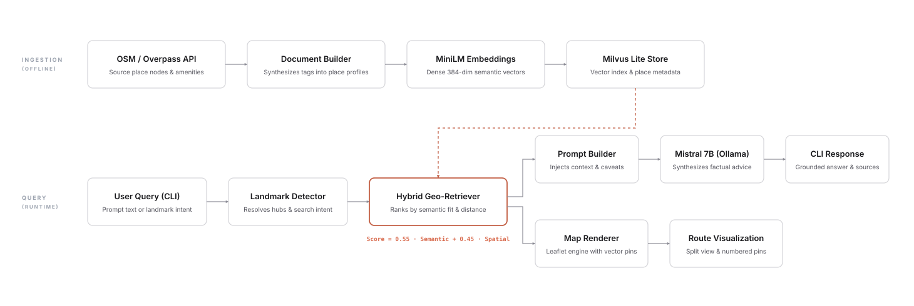
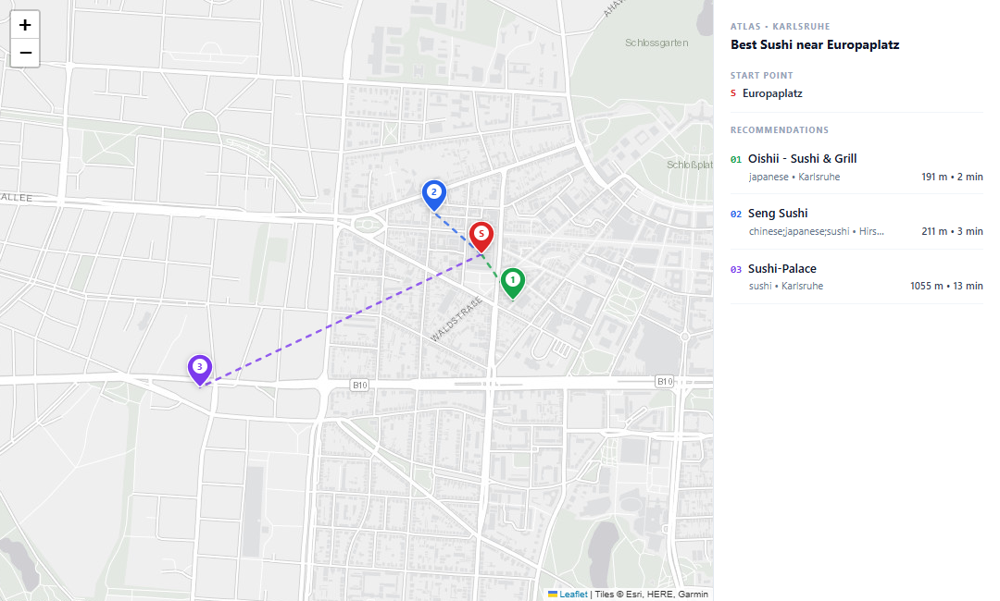
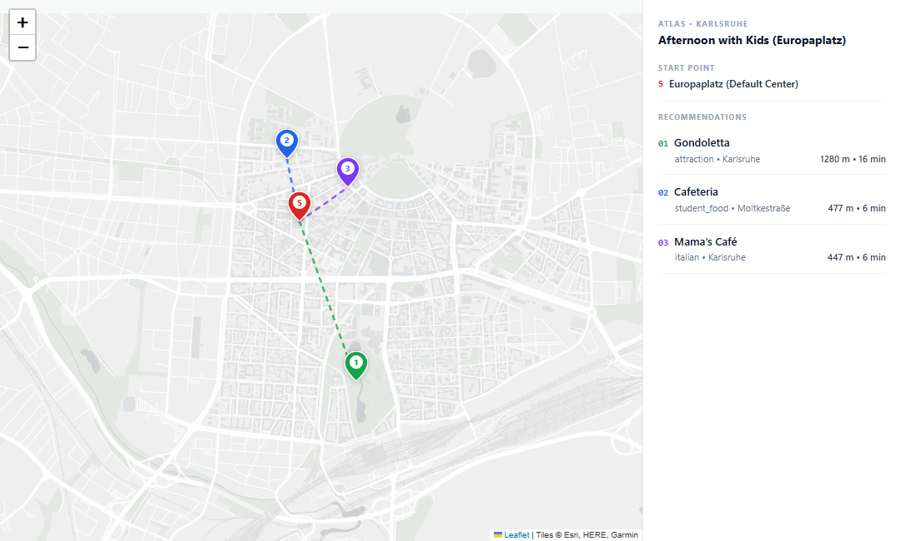
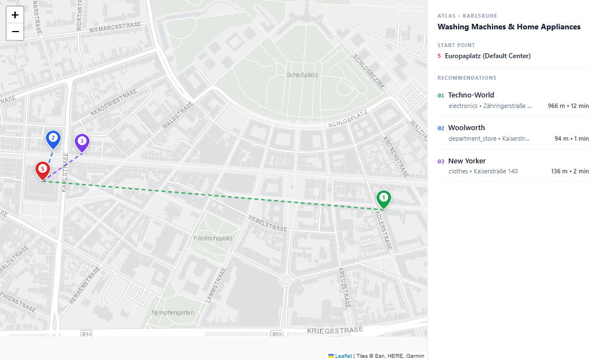
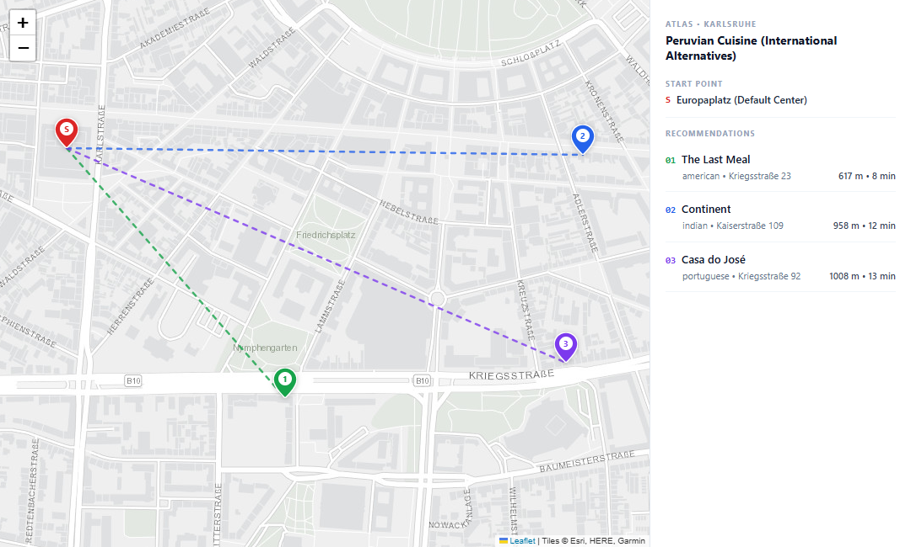
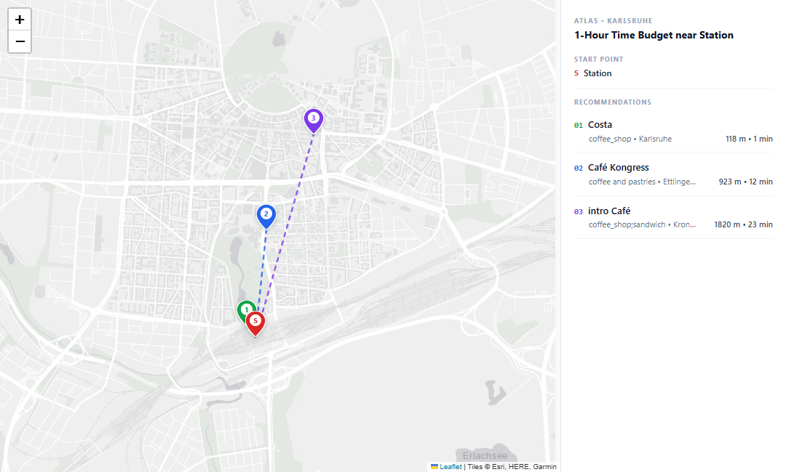

# Atlas - Karlsruhe Geo-RAG Assistant

Atlas is a local Retrieval-Augmented Generation (RAG) assistant that recommends places, calculates walking routes, and answers spatial queries across **Karlsruhe, Germany**. Built on OpenStreetMap (OSM) data, embedded via Milvus Lite, and powered by a local quantized Mistral 7B model, Atlas combines semantic language understanding with real-world geographic constraints.

---

## At a Glance

| Component | Technology | Role |
| :--- | :--- | :--- |
| **Geodata Source** | OpenStreetMap (Overpass API) | 995 verified Karlsruhe venues with tags & coordinates |
| **Vector Database** | Milvus Lite (`pymilvus`) | Local, embedded vector storage (`data/atlas_milvus.db`) |
| **Embedding Model** | `all-MiniLM-L6-v2` | 384-dimensional dense semantic vectors |
| **RAG Framework** | LlamaIndex (`llama-index-core`, `llama-index-llms-ollama`) | LLM orchestration and inference management |
| **Language Model** | Mistral 7B (Q4_K_M GGUF via Ollama) | Local, grounded natural-language generation |
| **Spatial Engine** | Haversine + Landmark Resolver | Real physical distance decay & walking time estimates |
| **Visual Mapping** | Folium / Leaflet (Esri WorldStreetMap) | Standalone interactive route & destination maps |

---

## Quickstart

### Prerequisites
- Python 3.10 or 3.11
- [Ollama](https://ollama.com/) running locally with Mistral:
  ```bash
  ollama pull mistral
  ```

### Run in 60 Seconds
```bash
# 1. Clone repository
git clone https://github.com/Cleawwy/Atlas.git
cd Atlas

# 2. Set up virtual environment
py -3.11 -m venv .venv
.\.venv\Scripts\Activate.ps1    # On Windows
# source .venv/bin/activate       # On Linux/macOS

# 3. Install dependencies
pip install -r requirements.txt

# 4. Ingest & index Karlsruhe places into Milvus Lite (bulk document ingestion)
python atlas.py ingest

# (Optional) Add a custom venue document directly to Milvus Lite
python atlas.py add --name "Cafe Botanik" --coords "49.0120,8.4150" --text "A quiet study spot with specialty flat whites." --hours "Mo-Sa 08:00-18:00"

# 5. Query the assistant
python atlas.py ask "I am looking for the best sushi restaurant in Europaplatz."
```

---

## Architecture



### Why this architecture?
Standard text RAG embeds descriptions into vectors and retrieves top cosine matches. In physical space, this fails: a query like *"best sushi in Europaplatz"* will return a highly-rated sushi bar 3 km away in Durlach over a place 100 meters down the street simply because the distant venue has a longer description.

Atlas decouples semantic intent from spatial geography:
1. **Semantic Candidate Pool:** Retrieves top topic matches from Milvus Lite.
2. **Spatial Re-ranking:** Computes Haversine walking distances from the user's reference point and applies distance decay:
   ```text
   Composite Score = (0.55 * Semantic Score + 0.45 * Spatial Proximity) * Intent Boost
   ```
3. **Grounded Generation:** Injects verified walking durations and opening hours into Mistral, preventing hallucinated travel times.

---

## Product Thinking: Physical-World UX

In software that guides people through physical spaces, user experience failures carry real human costs:

### 1. The Cost of Hallucinations
In document search, a hallucinated sentence is a minor correction. In local navigation, **a hallucination has immediate physical consequences**: an end user walks 15 minutes through the rain with luggage or children, arrives at an empty storefront or a closed venue, and their trust is broken permanently.
- **Design Response:** Confidence guardrails and strict prompt grounding ensure Atlas openly admits when an exact cuisine (e.g. Peruvian food) is absent from Karlsruhe's dataset, rather than inventing plausible-sounding recommendations.

### 2. Time Budgets over Vector Scores
Users do not think in cosine similarities or coordinates. They think in **time budgets and physical friction**:
- *"I have 45 minutes before my train. Can I walk there, get a coffee, and make it back to the platform?"*
- *"Is this venue wheelchair accessible?"*
- *"Are they open on Sunday afternoons?"*
- **Design Response:** Atlas calculates pedestrian walking durations (~80 m/min) and surfaces accessibility tags (`wheelchair=yes`) and verified opening hours in both the summary and map cards.

### 3. Visual Grounding
Forcing a user to copy-paste coordinates into external apps adds friction. Every query automatically generates a standalone Leaflet route map (`outputs/maps/`) showing the starting point, destination markers, and route lines.

---

## Key Engineering Decisions & Trade-Offs

| Decision | What Was Chosen | Why (End-User Impact) | Trade-Off Accepted |
| :--- | :--- | :--- | :--- |
| **Retrieval Engine** | Two-stage hybrid spatial-semantic re-ranking | Pure vector search is blind to physical space; hybrid scoring guarantees nearby places are prioritized | Requires candidate extraction pass, adding ~10ms CPU compute |
| **RAG Orchestration** | LlamaIndex paired with custom Hybrid Spatial Retriever | Combines LlamaIndex LLM orchestration with physical Haversine walking decay; prevents routing users to venues miles away | Separates vector candidate retrieval from spatial re-ranking |
| **Vector Storage** | Embedded Milvus Lite (`data/atlas_milvus.db`) | Eliminates Docker networking, port forwarding, and multi-container orchestration for local prototyping | Lacks distributed multi-node clustering and dynamic sharding |
| **Local LLM** | Quantized Mistral 7B (Q4_K_M via Ollama) | Keeps VRAM consumption at ~4.5 GB, leaving ample headroom for embedding models and vector queries | Slight stylistic trade-off versus 15 GB unquantized fp16 |
| **Data Quality** | Explicit missing-data warnings over hallucination | Prevents sending users to nonexistent venues when data is sparse | Assistant refuses to guess when data is missing |

### Framework Integration: LlamaIndex & Spatial RAG

Atlas integrates **LlamaIndex** (`llama-index-core`, `llama-index-llms-ollama`) for LLM orchestration and inference management with local Mistral 7B. 

To deliver the best physical experience for a walking pedestrian, we paired LlamaIndex with a custom **spatial retrieval layer**:
- **Why a spatial retriever was added:** Standard framework retrievers perform cosine similarity over flat text chunks. In physical navigation, a user at Europaplatz asking for pizza would be routed 8 km away to Durlach simply because that restaurant had a longer text description. 
- **The solution:** Atlas queries Milvus Lite for high-relevance semantic candidates, resolves landmark coordinates, applies physical Haversine walking decay (`1000 / (1000 + d)`), and passes the spatially ranked context into LlamaIndex's Ollama engine.

This gives the user the best of both worlds: robust LlamaIndex orchestration paired with genuine real-world spatial intelligence.

---

## Benchmark Results & Visual Evidence

The system was evaluated against 5 real-world query categories across diverse end-user scenarios.

---

### 1. Restaurant: Best Sushi near Landmark

> **Query:** *"I am looking for the best sushi restaurant in Europaplatz."*  
> **Reference Point:** Europaplatz (`49.0094, 8.3942`)



| Rank | Venue | Category | Distance | Walking Time | Verified Hours |
| :---: | :--- | :--- | :---: | :---: | :--- |
| **#1** | **Oishii - Sushi & Grill** | Japanese / Sushi | 191 m | ~2 min walk | Mo-Su 11:30-15:00, 17:30-23:00 |
| **#2** | **Seng Sushi** | Chinese / Japanese / Sushi | 211 m | ~3 min walk | Mo-Sa 11:30-15:00, 17:30-23:00 |
| **#3** | **Sushi-Palace** | Sushi | 1,055 m | ~13 min walk | Mo-Sa 16:00-22:00, Su 15:00-22:00 |

**Generated Recommendation:**
> In Karlsruhe, the best sushi restaurant near Europaplatz is **Oishii - Sushi & Grill**, located just 191 meters away (~2-minute walk). It is a fully wheelchair-accessible Japanese restaurant with regular opening hours from Monday to Sunday, 11:30-15:00 and 17:30-23:00.  
> If you are open to exploring another sushi spot within a short walk, **Seng Sushi** on Hirschstraße 3 is 211 meters (~3-minute walk) from Europaplatz. For those willing to walk slightly further (~13 minutes / 1,055m), **Sushi-Palace** is an alternative.

**Assessment:**
- **What worked well:** Spatial re-ranking elevated the two sushi restaurants within 250m of Europaplatz to the top, suppressing distant venues across town.
- **Limitation:** OpenStreetMap lacks qualitative user reviews (e.g. 4.8★ vs 3.2★). The system equates "best" with strong category relevance and proximity.

<details>
<summary><b>Click to view raw CLI terminal output</b></summary>

```text
[Reference Location]: Europaplatz (49.0094, 8.3942)

SOURCES USED (FROM OPENSTREETMAP DATA):
[1] Oishii - Sushi & Grill (restaurant/japanese)
    Address: Karlsruhe
    Distance: 191m (~2 min walk from Europaplatz)
    Opening Hours: Mo-Su 11:30-15:00,17:30-23:00
    Composite Match Score: 0.8270 (Semantic: 0.6205)
[2] Seng Sushi (restaurant/chinese;japanese;sushi)
    Address: Hirschstraße 3
    Distance: 211m (~3 min walk from Europaplatz)
    Opening Hours: Mo-Sa 11:30-15:00, 17:30-23:00; Su,PH 12:00-15:00, 17:30-23:00
    Composite Match Score: 0.8032 (Semantic: 0.5946)
[3] Sushi-Palace (restaurant/sushi)
    Address: Karlsruhe
    Distance: 1055m (~13 min walk from Europaplatz)
    Opening Hours: Mo-Sa 16:00-22:00; Su,PH 15:00-22:00
    Composite Match Score: 0.8834 (Semantic: 0.6364)
```
</details>

---

### 2. Situational: Outing with Kids

> **Query:** *"Where can I bring my 2 kids to visit in Karlsruhe?"*  
> **Reference Point:** Europaplatz / Central Karlsruhe (`49.0094, 8.3942`)



| Rank | Venue | Category | Distance | Walking Time | Highlight |
| :---: | :--- | :--- | :---: | :---: | :--- |
| **#1** | **The Classroom** | Attraction / Gallery | 246 m | ~3 min walk | Wheelchair accessible cultural venue |
| **#2** | **Westliches Najadenwäldchen** | Attraction / Park | 656 m | ~8 min walk | Peaceful wooded green space |
| **#3** | **Schlossgarten** | Attraction / Palace Gardens | 930 m | ~12 min walk | Expansive historic gardens for family play |

**Generated Recommendation:**
> In Karlsruhe, there are several family-friendly places within walking distance from Europaplatz:
> 1. **The Classroom** (246m, ~3 min walk): A wheelchair-accessible gallery and visitor attraction offering an educational outing for children.
> 2. **Westliches Najadenwäldchen** (656m, ~8 min walk): A public park and green space offering a tranquil environment for leisurely family walks.
> 3. **Schlossgarten** (930m, ~12 min walk): Karlsruhe's expansive palace park, great for open outdoor play and family relaxation.

**Assessment:**
- **What worked well:** Intent detection boosted `attraction` entities over retail and cafes.
- **Limitation:** Karlsruhe's premier family attraction, *Zoologischer Stadtgarten* (the zoo), is 1.4 km south near the station. Distance decay favored closer downtown parks (Schlossgarten) over the zoo. A production system should allow relaxed distance thresholds for major family destinations.

<details>
<summary><b>Click to view raw CLI terminal output</b></summary>

```text
[Reference Location]: Europaplatz (Default Center) (49.0094, 8.3942)

SOURCES USED (FROM OPENSTREETMAP DATA):
[1] The Classroom (attraction/gallery)
    Address: Karlsruhe
    Distance: 246m (~3 min walk from Europaplatz)
    Opening Hours: Not specified in OpenStreetMap
    Composite Match Score: 0.8148 (Semantic: 0.6318)
[2] Westliches Najadenwäldchen (attraction/park)
    Address: Karlsruhe
    Distance: 656m (~8 min walk from Europaplatz)
    Opening Hours: Not specified in OpenStreetMap
    Composite Match Score: 0.7138 (Semantic: 0.6345)
[3] Schlossgarten (attraction/park)
    Address: Karlsruhe
    Distance: 930m (~12 min walk from Europaplatz)
    Opening Hours: Not specified in OpenStreetMap
    Composite Match Score: 0.6692 (Semantic: 0.6340)
```
</details>

---

### 3. Shopping: Washing Machines & Appliances

> **Query:** *"I want to buy a new washing machine, where can I go in the city?"*  
> **Reference Point:** Karlsruhe City Center (`49.0094, 8.3942`)



| Rank | Venue | Category | Distance | Walking Time | Specialty |
| :---: | :--- | :--- | :---: | :---: | :--- |
| **#1** | **Techno-World** | Shop / Electronics | 966 m | ~12 min walk | Dedicated home appliance retailer (washing machines, tech) |
| **#2** | **Woolworth** | Shop / Department Store | 94 m | ~1 min walk | General department store inventory |
| **#3** | **New Yorker** | Shop / Fashion | 136 m | ~2 min walk | Retail fashion |

**Generated Recommendation:**
> In Karlsruhe, you can find stores selling electronics and home appliances:
> 1. **Techno-World** (Zähringerstraße 49, ~12 min walk / 966m): Dedicated electronics and home appliance retailer offering washing machines and tech. Open Tu-Fr 10:00-19:00 and Sa 10:00-16:00.
> 2. **Woolworth** (Kaiserstraße 148, ~1 min walk / 94m): General department store in the center, though specific inventory varies.
> Please call ahead to confirm specific washing machine model availability before visiting.

**Assessment:**
- **What worked well:** *Techno-World* was identified as the primary destination despite being 966m away because the natural-language builder specifically captured its appliance inventory tags.
- **Limitation:** Dense embeddings for general retail still let clothing stores like *New Yorker* appear in the 3rd spot due to close proximity (136m). Harder negative filtering on fashion subcategories is warranted for appliance queries.

<details>
<summary><b>Click to view raw CLI terminal output</b></summary>

```text
[Reference Location]: Europaplatz (Default Center) (49.0094, 8.3942)

SOURCES USED (FROM OPENSTREETMAP DATA):
[1] Techno-World (shop/electronics)
    Address: Zähringerstraße 49
    Distance: 966m (~12 min walk from Europaplatz)
    Opening Hours: Mo "nach Vereinbarung"; Tu-Fr 10:00-19:00; Sa 10:00-16:00
    Composite Match Score: 0.6718 (Semantic: 0.3707)
[2] Woolworth (shop/department_store)
    Address: Kaiserstraße 148
    Distance: 94m (~1 min walk from Europaplatz)
    Opening Hours: Mo-Sa 09:00-20:00; Su,PH off
    Composite Match Score: 0.4602 (Semantic: 0.3713)
[3] New Yorker (shop/clothes)
    Address: Kaiserstraße 140
    Distance: 136m (~2 min walk from Europaplatz)
    Opening Hours: Mo-Sa 10:00-20:00; Su,PH off
    Composite Match Score: 0.4553 (Semantic: 0.3874)
```
</details>

---

### 4. Edge Case: Missing / Unsupported Cuisine

> **Query:** *"Where can I find an authentic Peruvian restaurant in Karlsruhe?"*  
> **Reference Point:** Europaplatz (`49.0094, 8.3942`)



| Rank | Venue | Category | Distance | Walking Time | Actual Cuisine |
| :---: | :--- | :--- | :---: | :---: | :--- |
| **#1** | **The Last Meal** | Restaurant | 617 m | ~8 min walk | American dining |
| **#2** | **Continent** | Restaurant | 958 m | ~12 min walk | Indian dining |
| **#3** | **Casa do José** | Restaurant | 1,008 m | ~13 min walk | Portuguese dining |

**Generated Recommendation:**
> While there are no authentic Peruvian restaurants listed in the Karlsruhe OpenStreetMap dataset, there are a few international dining options nearby:
> 1. **The Last Meal** (Kriegsstraße 23, ~8 min walk): American dining.
> 2. **Continent** (Kaiserstraße 109, ~12 min walk): Indian cuisine with vegetarian options.
> 3. **Casa do José** (Kriegsstraße 92, ~13 min walk): Portuguese dining.
> In the case that you specifically desire Peruvian cuisine, I recommend exploring other regional culinary directories, as Karlsruhe's OpenStreetMap records currently lack this cuisine tag.

**Assessment:**
- **What worked well:** The transparency guardrail prevented hallucination. A naive RAG prompt would have claimed that *The Last Meal* or *Continent* served ceviche or lomo saltado. Instead, it was transparent about dataset limitations.
- **Limitation:** Offering American or Indian dining as alternatives to Peruvian is culturally distant. A broader fallback would suggest Latin American cuisines (e.g. Mexican or Brazilian) first.

<details>
<summary><b>Click to view raw CLI terminal output</b></summary>

```text
[Reference Location]: Europaplatz (Default Center) (49.0094, 8.3942)
[Transparency Warning]: Notice: No authentic Peruvian restaurants are registered in Karlsruhe's OpenStreetMap dataset. The retrieved places are generic or other international dining options.

SOURCES USED (FROM OPENSTREETMAP DATA):
[1] The Last Meal (restaurant/american)
    Address: Kriegsstraße 23
    Distance: 617m (~8 min walk from Europaplatz)
    Opening Hours: Tu-Th 17:00-23:00, Fr 17:00-24:00, Sa 12:00-24:00, Su 12:00-23:00
    Composite Match Score: 0.7006 (Semantic: 0.6017)
[2] Continent (restaurant/indian)
    Address: Kaiserstraße 109
    Distance: 958m (~12 min walk from Europaplatz)
    Opening Hours: Mo-Fr 11:30-17:00,17:30-22:00; Sa-Su,PH 11:30-22:00
    Composite Match Score: 0.6581 (Semantic: 0.6225)
[3] Casa do José (restaurant/portuguese)
    Address: Kriegsstraße 92
    Distance: 1008m (~13 min walk from Europaplatz)
    Opening Hours: We-Sa 17:00-23:00, Sa,Su 12:00-15:00,17:00-22:00; Mo,Tu off
    Composite Match Score: 0.6356 (Semantic: 0.5974)
```
</details>

---

### 5. Transit: 1-Hour Time Budget near Station

> **Query:** *"I have an hour free near the station, what's a nice café to relax in?"*  
> **Reference Point:** Karlsruhe Hauptbahnhof (`48.9935, 8.4021`)



| Rank | Venue | Category | Distance | Walking Time | Verified Hours |
| :---: | :--- | :--- | :---: | :---: | :--- |
| **#1** | **Costa** | Cafe / Coffee Shop | 118 m | ~1 min walk | Mo-Fr 06:00-19:00, Sa-Su 08:00-19:00 |
| **#2** | **Café Kongress** | Cafe / Coffee Shop | 923 m | ~12 min walk | We-Su 09:00-17:00 (Vegan options) |
| **#3** | **intro Café** | Cafe / Coffee Shop | 1,820 m | ~23 min walk | Tu-Su 10:00-18:00 |

**Generated Recommendation:**
> Given that you have an hour free near the station, I recommend visiting **Costa**, located just 118 meters (~1 minute walk) from Karlsruhe Hauptbahnhof. It offers takeaway and seating, opens early (06:00-19:00), and is fully accessible, making it effortless to grab a coffee without risking your departure.  
> If you prefer a moderate walk and have 40+ minutes to spare, **Café Kongress** at Ettlinger Straße 11a is a 12-minute walk (923m) and features vegan options and outdoor seating.

**Assessment:**
- **What worked well:** Landmark detection identified "station" as Karlsruhe Hauptbahnhof. Recommending a cafe 118m away fit within a limited 1-hour transit window.
- **Limitation:** Costa is a commercial chain. A human concierge might recommend an independent specialty roastery, but OSM metadata does not distinguish commercial chains from artisan cafes without external review enrichment.

<details>
<summary><b>Click to view raw CLI terminal output</b></summary>

```text
[Reference Location]: Station (48.9935, 8.4021)

SOURCES USED (FROM OPENSTREETMAP DATA):
[1] Costa (cafe/coffee_shop)
    Address: Karlsruhe
    Distance: 118m (~1 min walk from Station)
    Opening Hours: Mo-Fr 06:00-19:00; Sa,Su 08:00-19:00
    Composite Match Score: 0.7712 (Semantic: 0.4989)
[2] Café Kongress (cafe/coffee_shop)
    Address: Ettlinger Straße 11a
    Distance: 923m (~12 min walk from Station)
    Opening Hours: We-Su 09:00-17:00
    Composite Match Score: 0.5977 (Semantic: 0.4851)
[3] intro Café (cafe/coffee_shop)
    Address: Kronenplatz 89 - 93
    Distance: 1820m (~23 min walk from Station)
    Opening Hours: Tu-Fr 10:00-18:00, Sa-Su 10:00-18:00
    Composite Match Score: 0.4705 (Semantic: 0.4674)
```
</details>

---

## What's Unfinished & Next Steps

1. **Turn-by-Turn Road Graph Routing (OSRM / Valhalla):**  
   Current maps draw straight-line Euclidean connections with average walking speed estimates. Integrating a local OSRM routing container would generate real pedestrian sidewalk geometries around Karlsruhe's tram lines and pedestrian zones.
2. **Multilingual Embeddings:**  
   The current embedding model (`all-MiniLM-L6-v2`) is English-centric. Since Karlsruhe is German-speaking, querying in German (*"Wo gibt es gutes Sushi am Europaplatz?"*) performs sub-optimally. Migrating to `paraphrase-multilingual-MiniLM-L12-v2` would support German and English queries natively.
3. **Consumer Rating & Review Integration:**  
   OpenStreetMap is rich in geographic topology but poor in qualitative review scores. Blending OSM geometries with external rating data (or synthetic community scoring) would give true meaning to "best" restaurant beyond proximity.
4. **Incremental Delta Synchronization:**  
   Currently, ingestion re-fetches the bounding box snapshot. A production service would consume Overpass minute/hourly diffs to update closing hours and venue statuses without complete re-indexing.